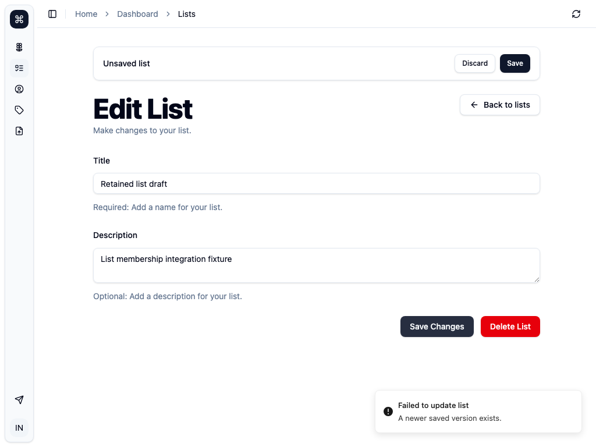
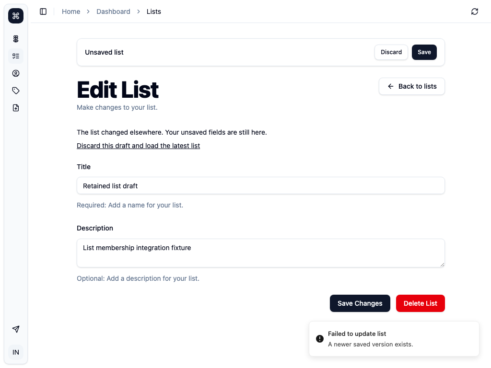

# Structured editor conflict recovery

These Chromium captures use disposable local SQLite data and loopback service
providers. They contain no member data or credentials.

The test sends a stale list update to the real server. It keeps the returned
`CONFLICT` code and changes only its message to `A newer saved version exists.`
It returns that error through the app's streamed tRPC transport.

Before the change, the form keeps the draft but has no recovery action:



After the change, the form keeps the same draft and offers explicit recovery:



The integration test also checks lists, listings, and profile fields at desktop
and phone widths. It checks the stored row after rejected writes, explicit
recovery, and save/reopen/reload. A non-conflict error with the old conflict
wording must keep the draft without adding a conflict recovery action.

Run from the repository root with free loopback ports:

```sh
INTEGRATION_PORT=3250 node apps/main/scripts/run-integration-local.mjs editor-conflict.integration.ts
```

The original server messages and UI layout have no changes. The intentional
change is that the error code selects conflict recovery.
