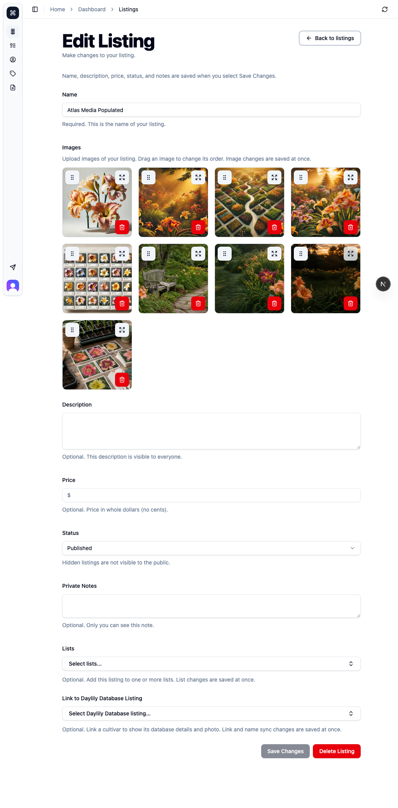
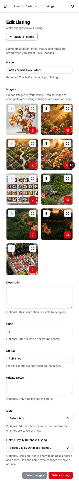
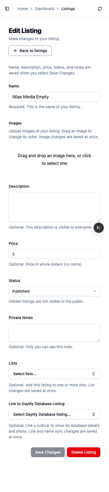
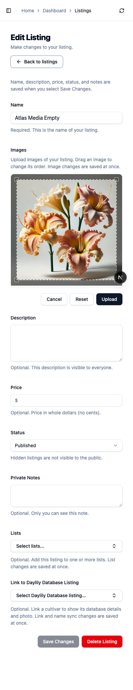

# Deterministic Atlas media fixtures

The media flows now own their required image counts. The managed runner copies
the realistic seed, adds two reserved listings, and supplies local images. The
listing states have nine and zero images. The existing grower profile has five
reserved local image records. Profile details, catalog listings, lists, notes,
and other members remain in the disposable copy.

The runner refuses media flows, including `all`, when `BASE_URL`, `DATABASE_URL`,
or `ATLAS_DATABASE_URL` is supplied. It stops before a server check or output
write. The fixture helper always creates a new snapshot. It has no destination
argument. Canonical seed and production writes are outside this path.

## Reproduce

Run from the repository root with a current realistic seed and development
service configuration. The runner loads the development env files. Do not wrap
these commands in `pnpm env:dev`, which can supply an explicit database.

```sh
env -u BASE_URL -u DATABASE_URL -u ATLAS_DATABASE_URL ATLAS_PORT=3337 \
  node apps/main/scripts/run-atlas-flow.mjs listing-media \
  --output=apps/main/local/atlas/listing-media

env -u BASE_URL -u DATABASE_URL -u ATLAS_DATABASE_URL ATLAS_PORT=3337 \
  node apps/main/scripts/run-atlas-flow.mjs profile-management \
  --output=apps/main/local/atlas/profile-management
```

Use a free owner port. The [flow registry](../../../scripts/atlas-flows.mjs) is
the source for entry points, behavior rules, states, and test commands.

## Baseline and proof

Proof date: October 12, 2026. Base:
`d286e8f233c4f85aef08dd00ff991da405aaf2bf`.
Browser: Chromium `140.0.7339.16`, Playwright `1.55.0`, macOS. Desktop viewport:
1024 × 768. Phone-sized viewport: 402 × 874. Both use the Chromium desktop
engine; this is viewport proof, not a mobile device or Safari test.

| Run                                 | Listing source count | Empty source count | Profile source count | Result                                                                      |
| ----------------------------------- | -------------------: | -----------------: | -------------------: | --------------------------------------------------------------------------- |
| Original supported flows            |                    1 |                  0 |                    5 | Both stopped at the diagnostic gate after sign-in; media cases did not run. |
| Diagnostic-corrected original cases |                    1 |                  0 |                    5 | Listing: six count failures, five passes. Profile: 11 passes.               |
| Managed current seed                |                    1 |                  0 |                    5 | Listing: 11 passes. Profile: 11 passes.                                     |
| Managed disposable source variation |                    4 |                  2 |                    1 | Listing: 11 passes. Profile: 11 passes.                                     |

The first baseline exposed a diagnostic-format defect. Atlas now reads the
current direct and forwarded `console_message` envelopes. It keeps the full
line on failure. Only the exact existing Clerk development warning at `warn`
level passes. Physical browser errors retain their severity even if their JSON
claims `warn`. Malformed records, changed warning text, other diagnostics, and
structured error records fail. Native expected-404 counts remain exact.

The original listing populated, preview, reorder, and delete states had no
successful baseline capture. The images below are **after-only** proof. The
fixture names and images differ from the source records. They are not a matched
visual before/after comparison.

## Functional and data checks

- Keep all original image-count, populated/empty, preview, crop, active pointer
  reorder, and delete-confirmation assertions. Keep profile draft, URL warning,
  URL validation, save-button, content-editor, and preview checks.
- Real SQLite integration tests use tracked migrations and two source-count
  variants. Check source byte preservation, local URLs, image order, foreign
  keys, cleanup, representative content, and other members' media.
- CLI negative tests cover both media flows and `all` with each attach/database
  override. The database and existing output stay unchanged.
- The current seed SHA-256 stayed unchanged. The variation is a separate local
  backup. It changes original source media counts, then the managed command
  makes its own disposable copy. No original source listing is repaired.
- Browser traces stay private. A private command shim adds only
  `--trace=on`; no source configuration or assertions change. Network summaries
  contain counts, local asset paths, and response status only.
- Current browser runs: zero console errors, page errors, recorded request
  failures, HTTP errors, or upload requests. All fixture image requests returned 200.
  Each fresh page reports the expected Clerk development-key warning. Traces
  also contain one listing and four profile navigation responses without a
  final status at teardown. These are not counted as successful responses.

The variation runs also had zero recorded console/page errors, HTTP errors,
request failures, or upload requests. All fixture image responses were 200.
The variation traces contain one listing and five profile responses without a
final status at teardown. Both source hashes stayed unchanged, and the original
local seed manifest was restored byte for byte.

The active reorder capture stops before drop. The delete capture stops at
confirmation. The crop capture stops before upload. These states do not prove
external storage writes. The existing full-app integration test covers saved
reorder and deletion.

## Local validation

- `pnpm main lint`: pass; 0 errors and 1174 existing warnings. Warning policy stays unchanged.
- `pnpm typecheck`: pass.
- Prettier on all changed source/test files and this report: pass.
- Focused Vitest: 36 passes across `atlas-media-fixtures`, `atlas-browser-diagnostics`, `atlas-flows`, and `realistic-data-snapshot` tests.
- Existing full-app listing-media and profile-workflow integration files: 8 passes on disposable loopback services. Includes saved reorder/deletion and desktop/phone-sized profile controls.
- Fresh separate-context code review: clean after the physical error-severity correction. De-slop and reduce-complexity checks complete.

## Selected after-only captures

These are full Atlas captures from synthetic listing editors or a profile
interaction surface. They contain no source private notes or stored browser
state. The full realistic profile screenshots, source baseline captures, auth
files, raw logs, databases, and traces are kept out of this public evidence.

### Desktop populated listing



### Phone-sized populated listing



### Phone-sized empty listing



### Phone-sized crop controls



### Profile preview


