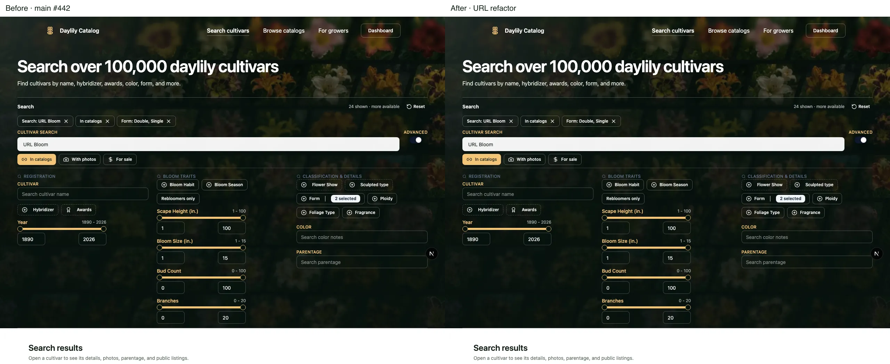
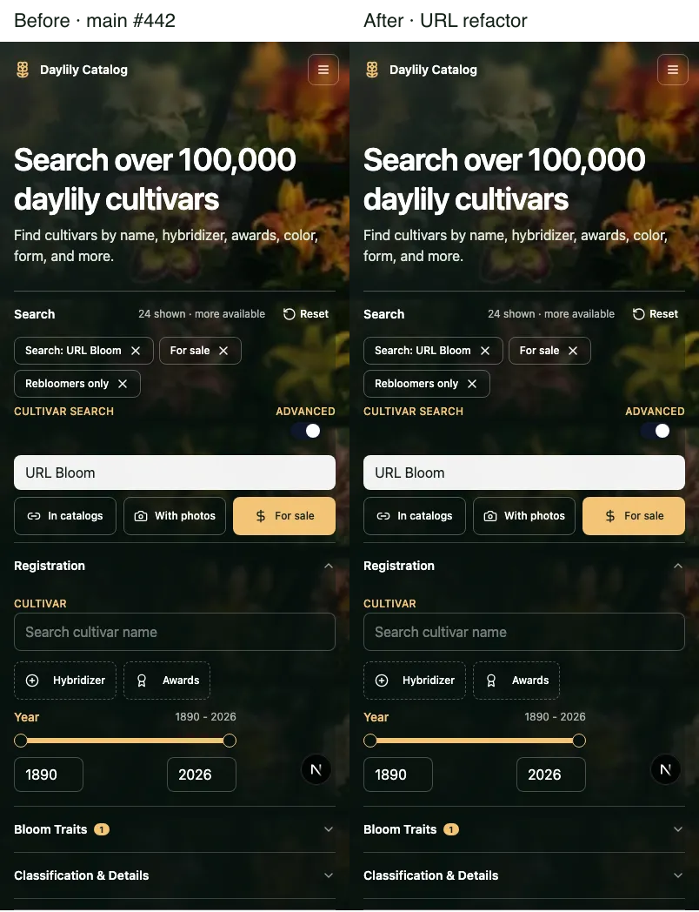

# Cultivar browser URL comparison

Base: `359c292a205bbf280d6ebed271c262a803eb67d5` (main, #442).
Final: the app source in this PR. The PR body records its exact head.
Captures: local Chromium 140.0.7339.16 (Playwright 1.55.0), October 11, 2026. Desktop: 1280 × 720. Mobile: 402 × 874.
Data: 55 synthetic cultivars and their public listings in this checkout's disposable integration database. No member or production data is included.

## Matched captures

The previews show the first 1000 pixels of each full-page capture. The links retain the full page. WebP conversion is lossless.





| State                       | Before (full size)                              | After (full size)                           | Pixel result                                                                                                                         |
| --------------------------- | ----------------------------------------------- | ------------------------------------------- | ------------------------------------------------------------------------------------------------------------------------------------ |
| Desktop shared advanced URL | [Before](baseline-desktop-shared-advanced.webp) | [After](after-desktop-shared-advanced.webp) | Identical                                                                                                                            |
| Desktop 48 loaded results   | [Before](baseline-desktop-loaded-results.webp)  | [After](after-desktop-loaded-results.webp)  | Identical                                                                                                                            |
| Mobile default browse       | [Before](baseline-mobile-default.webp)          | [After](after-mobile-default.webp)          | Identical                                                                                                                            |
| Mobile shared advanced URL  | [Before](baseline-mobile-shared-advanced.webp)  | [After](after-mobile-shared-advanced.webp)  | 12,458 background pixels differ by at most 2/255 per channel; bounds x=0..265, y=0..403. No control or layout difference is visible. |

The settled base and final capture runs each passed all three browser tests. Later test assertions add a JavaScript-disabled SSR check, explicit filter changes within the same history entry, and console/network checks for all three flows. These later checks passed on final source. They add no screenshot state.

## Preserved behavior

| Input or action                                                 | Base and final result                                                                                           |
| --------------------------------------------------------------- | --------------------------------------------------------------------------------------------------------------- |
| Missing controls                                                | Name sort; In catalogs enabled; query and other filters empty; Basic mode                                       |
| Repeated keys                                                   | First value wins                                                                                                |
| Literal Booleans                                                | Only `true` enables photo, For sale, and rebloom. Only `false` disables In catalogs.                            |
| Empty advanced key, or `advanced=false` with an advanced filter | Advanced mode opens                                                                                             |
| Facet values                                                    | Trim, remove empty values and duplicates, then sort on serialization                                            |
| Query and range text                                            | Read the original text; trim for the share URL. Range validation stays in the current API.                      |
| `oldest` or an invalid sort                                     | Name sort                                                                                                       |
| Unknown keys, `hasPhoto`, `photosFirst`, `offset`               | Current browser serialization drops them. `photosFirst` remains an API-only control.                            |
| Filter and sort changes                                         | Replace the current history entry; preserve its identity                                                        |
| First Back from a result page                                   | Consume the matching entry snapshot; restore 48 loaded results and the scroll anchor; use controls from the URL |
| New tab with the same shared URL                                | Load 24 results; no pagination depth in the URL                                                                 |
| Forward, then Back again                                        | The consumed snapshot is absent; load 24 results                                                                |
| Photo filter on the synthetic fixture                           | Empty results, then 24 results when cleared                                                                     |

The six existing client tests remain unchanged. They cover advanced filters, old pagination rejection, and same-entry restoration. Two URL tests cover all current controls and the Next/browser input shapes. Three Chromium integration tests cover the visible flows above.

## Run

From the repository root:

```sh
INTEGRATION_PORT=3260 node apps/main/scripts/run-integration-local.mjs cultivar-url-controls.integration.ts
```

Set `CULTIVAR_URL_EVIDENCE_DIR` to a local directory to capture the four states. The runner creates an owned runtime-flag file when no path is supplied. The test enables public search, builds its local index, then restores flags and the existing search directory and removes its fixture records. The runner removes its database and owned flag file.

## Limits and corrected verification

The initial baseline passed before app edits. One early final run clicked Load more against the transient SSR browse batch before the client search settled. It failed to retain the loaded page. The test now waits for the real initial response and requested sort result. The same corrected test passed on the exact base and final app source. No product fix was made for this timing.

These checks use local service providers. They do not test live Clerk, hosted ChatGPT, or production. No API, MCP, plugin, auth, search-service, or database query contract was changed. Lint remains warning-only. React styled-jsx attribute warnings in the existing jsdom client suite are a baseline test limitation.
